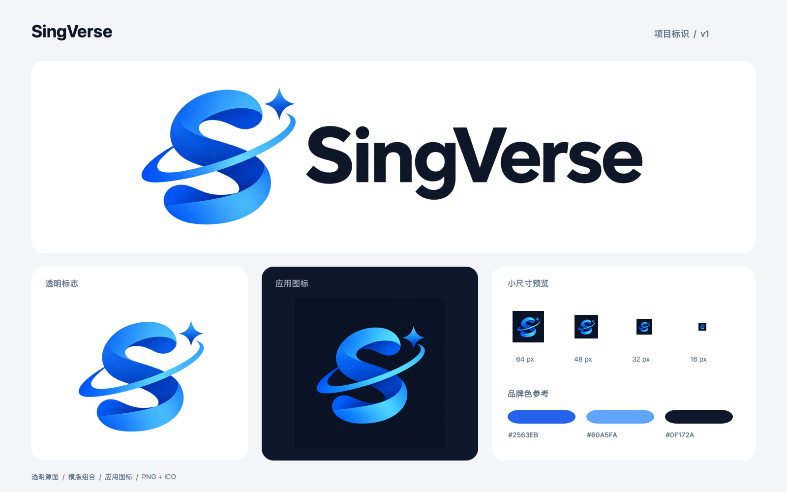

# SingVerse 项目标识

设计日期：2026-11-09。主体由蓝色的 **S 声波丝带、星轨和一枚四角星**组成，呼应 SingVerse 的名字与家庭 KTV 定位。色彩参考现有管理端的蓝色和深石板色；字标使用准确大小写 `SingVerse`。

## 素材清单

| 文件 | 实际尺寸 | 用途 |
|---|---|---|
| [singverse-logo-mark.png](singverse-logo-mark.png) | 1254 × 1254 | 透明底独立标志，适合页面、启动页和项目介绍 |
| [singverse-logo-horizontal.png](singverse-logo-horizontal.png) | 2172 × 724 | 透明底横版组合，深色 `SingVerse` 字标，适合浅色背景 |
| [singverse-app-icon-master.png](singverse-app-icon-master.png) | 1254 × 1254 | 深色底、完整方形应用图标源图 |
| [icons/icon-1024.png](icons/icon-1024.png) | 1024 × 1024 | 通用高分辨率打包图标 |
| `icons/icon-{尺寸}.png` | 16、32、48、64、72、96、128、144、180、192、256、512、1024 | 从同一应用图标源图等比缩小导出的 PNG |
| [favicon.ico](favicon.ico) | 内含 16、32、48 三档 | 浏览器或支持 ICO 的打包工具 |
| [singverse-tv-banner.png](singverse-tv-banner.png) | 320 × 180 | 同一横版 Logo 在白色底上的 TV 桌面横幅 |
| `icons/logo-mark-{尺寸}.png` | 128、512 | 网页标识和 Android 自适应前景共用的透明派生图 |
| [singverse-brand-preview.png](singverse-brand-preview.png) | 1600 × 1000 | 浅色背景、应用图标和实际小尺寸效果的展示图 |

这些文件是多端共用的品牌源素材，已接入手机 APK、Android TV 和管理平台的构建资源；正常打包会包含相应图标。各工程保存独立的派生资源，构建与部署不需要读取根目录素材，也不依赖图像生成工具。

## 已接入的位置

| 工程 | 使用位置 | 构建资源 |
|---|---|---|
| 手机 APK | 系统启动图标与圆形图标，Android 8+ 使用自适应前景和深色背景 | `services/singverse-mobile/android/app/src/main/res/` 下的 `mipmap-*`、`drawable-nodpi/singverse_logo_mark.png` 和相关 XML |
| Android TV | 系统图标、320 × 180 桌面横幅、应用内品牌标识 | `services/singverse-tv/app/src/main/res/` 及品牌绘制组件 |
| 管理平台与亲友 H5 | 浏览器图标、添加到主屏幕图标、管理登录页与侧栏、H5 顶部标识 | `services/singverse-frontend/public/assets/brand/`，随完整 `dist` 进入 Nginx 或 Java 交付 |

修改品牌源图后，需要同步更新上述工程中的派生资源。现有 `make mobile-build`、`make tv-build`、`make frontend-build` 及管理平台交付流程继续使用这些工程内资源。

## 使用约定

- 优先从应用图标源图或透明标志缩小导出，保持长宽比；避免放大小尺寸图标或拉伸横版 Logo。
- 应用图标保留完整方形与四角背景，圆角由目标平台处理。两个 Android 工程均设置了独立透明前景和深色背景，前景内缩 21% 以保留遮罩安全区；旧版系统继续使用对应密度的方形图标。
- Android 传统启动图标可分别取 48、72、96、144、192px 对应 mdpi、hdpi、xhdpi、xxhdpi、xxxhdpi。NAS、Web 或打包工具使用其要求的相应尺寸。
- 横版 Logo 使用深色字标，放在白色或浅色背景上。深色背景可使用独立标志或深色底应用图标。
- 色板参考：主蓝 `#2563EB`、亮蓝 `#60A5FA`、深蓝 `#1D4ED8`、深石板 `#0F172A`。生成图的渐变和背景像素存在自然色阶，色板用于后续界面配色。
- 预览图仅用于展示，打包时选择独立图标文件。

## 生成与检查

主体、透明背景处理、应用图标和横版字标使用内置 `image_gen` 生成；完整提示词见 [generation-prompts.md](generation-prompts.md)。保留生成图的实际原始分辨率，未通过放大宣称更高分辨率。多尺寸 PNG 由同一源图通过系统 `sips` 缩小导出，ICO 封装对应的三张 PNG；预览图与 TV 横幅使用已保存素材排版合成，不重新生成标志。

本次素材检查包括 PNG 的实际尺寸、透明通道、应用图标不透明性、ICO 的三档内容，以及浅色背景、横版文字和 16–64px 效果。Android 自适应前景的可见像素在 108dp 画布上的最大半径约 31.73dp，位于 33dp 半径的安全区内。

多端接入已通过 `make frontend-check`、前端登录/导航/亲友页面的 21 项现有行为测试、`make mobile-check mobile-build`、`make tv-build`，以及前端构建后的 `WebWelcomeTest,AdminWebTest` 四项隔离 HTTP 测试。另逐一核对了两份 debug APK 内五档传统图标与自适应资源、TV 横幅和完整前端 `dist` 中的品牌文件。手机、电视和 NAS 实机的启动器及显示效果仍需真机验收；本次构建结果不代表正式签名发布或远程 CI 已通过。
