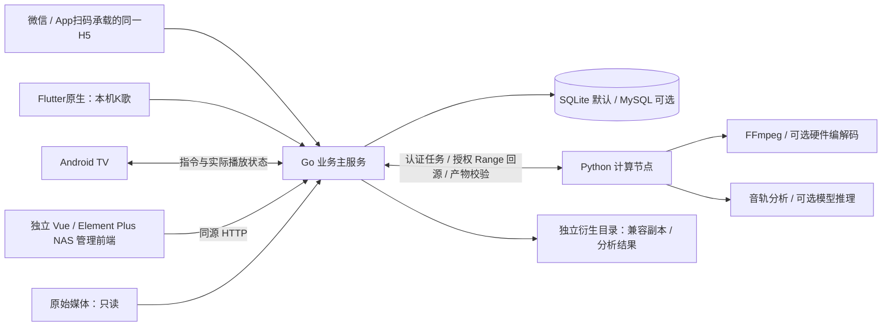
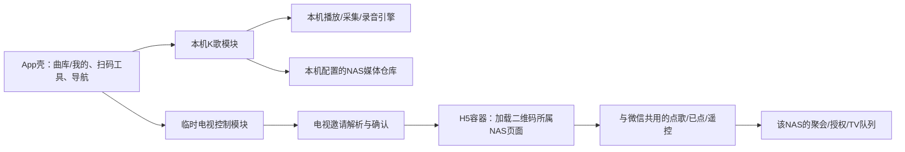
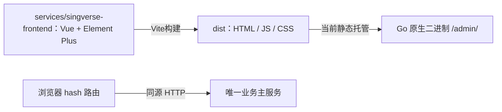

# 架构

SingVerse 采用四端入口、Go 业务主服务与 Python 计算节点。Go/Gin/database/sql + sqlx 管理业务和同源 H5；Python 执行媒体探测、实时 HLS、离线兼容版本、音轨分析及可选伴奏分离，可与 Go 同机或独立部署。功能和硬件验收分别记录，见[验证记录](verification.md)。

Go 已提供曲库、会话、队列和计算编排，TV/H5 已有点唱业务；Flutter 提供本机曲库播放、唱录、作品及扫码 H5。架构图不代表全部设备、模型或硬件已经验收，实际限制见各模块 README 和本次验证记录。

## 职责与调用边界

| 部分 | 职责 | 当前实现 |
|---|---|---|
| Go主服务 | 统一授权、曲库、会话、队列、业务数据库；校验/编排任务，接收和确认结果 | 曲库、认证、聚会、队列、任务编排、结果和缓存、静态 H5 托管 |
| Python计算节点 | 服务端媒体探测、转解码、离线兼容副本、AI伴奏分析及其他重计算 | FastAPI/Uvicorn、认证回源、媒体探测、转码、音轨分析及可选模型执行 |
| TV / App | 实际播放、设备解码与输出；App 本机采集和录音 | TV 点唱与播放；App 曲库、后台播放、唱录、作品及扫码 H5 |
| 亲友H5 | 通过主服务参与电视聚会，和NAS管理职责分离 | 同一前端工程的 `/party/`：邀请确认、点歌、队列及授权遥控 |
| NAS管理前端 | 同源HTTP查询与管理；不绑定服务端语言 | Vue/TypeScript 管理端：账号、曲库、审核、伴奏任务、设备及系统设置，`/admin/` 静态托管 |

客户端不直接请求计算节点或数据库。Python不直接写业务数据库、变更聚会队列或持有完整用户会话；Go继续是业务状态权威，保留原客户端与计算节点契约。设备端正常播放所需的本机解码不迁移至Python；服务端的计算才由节点统一执行。

## 在项目中的集成方式

Python是项目内部的执行层，产品继续按曲库、播放兼容和AI能力组织。系统设置提供“性能节点配置”，仅供管理员管理内部计算服务，客户端不直连节点。AUTO 使用部署地址与共享凭据，MANUAL 使用加密配置，DISABLED 停用，架构图放在工程文档中。

局域网发现由 Go 接受管理员指令后执行有界单播探测，浏览器只接收节点名称、地址和短时发现标识。选择节点后 Go 与 compute 完成一次性挑战签名及加密凭据交换，再验证原有内部认证与业务回源，成功才保存为 MANUAL；不增加多节点调度。Go 私钥在业务库内用现有主密钥加密，compute 保存稳定节点 ID 与唯一绑定主服务公钥。首次配对以受限局域网为信任边界，已有绑定只能由同一私钥证明身份恢复；普通任务继续要求 Bearer，发现响应没有可复用凭据，客户端不直连配对接口。

| 功能入口 | Go负责 | Python负责 | 结果落点与故障体验 |
|---|---|---|---|
| 曲库扫描与媒体详情 | 来源身份、只读范围、索引、人工字段保护 | 媒体标签、技术探测与重分析 | Go校验后更新索引；失败保留原索引和人工信息 |
| 兼容与转换 / 播放错误恢复 | 校验设备能力、决定直放或转换、创建与核对任务 | 重封装、服务端转解码和兼容副本生成 | 独立衍生目录；客户端拿Go授权的播放引用，失败可选择兼容版本 |
| 曲库媒体详情 / AI设置 | 素材授权、模型配置、任务状态、分析结果复核 | 音轨分析、伴奏分离及可选模型推理 | 建议结果先展示，确认后由Go保存；不自动覆盖人工伴奏标注 |
| 系统与备份 | 汇总后台处理可用性、诊断与失败原因 | 仅报告自身真实能力/执行结果 | 诊断嵌在已有系统页；服务离线不会退出聚会或中断可直放媒体 |

扫描时由计算服务只读提取标签，转码和音轨任务同样经授权回源；结果由 Go 校验并入库。模型安装、硬件编码器存在与实际素材试跑分别判断，原型不代表已开放能力。

后续任务在各业务应用服务内完成权限与输入校验，再经同一内部计算客户端调用Python。任务状态、媒体引用、结果审核与数据库写入属于Go；Python负责本地资源调度、工具/模型执行与受限工作目录。新增能力复用这一条路径，不能让前端直连执行层或让Python绕过业务权限写入。

`make backend-check`将Python真实HTTP/契约测试、Go 静态分析/race/构建与两进程集成测试纳入一个入口。计算服务未启动、上线与退出时都验证主服务健康及H5；计算服务不可用时不宣告业务主服务故障。该检查已接入singverse-backend工作流，修改任一服务会触发，不需要MySQL。

## 当前连接与故障隔离

- 节点默认`127.0.0.1:8090`；`GET /health`仅报告进程UP，`GET /internal/v1/capabilities`声明已实现能力；内部凭据、ffprobe 和 ffmpeg 就绪时提供 `media-remote-tags`；不再声明旧 `media-tags`。健康不等于模型/转码/GPU就绪，也不代表性能验收。
- Go的`COMPUTE_NODE_URL`默认为空，内部探测返回disabled；配置后按需探测，2秒连接/请求超时，不跟随重定向；不可达、异常状态、错误响应或协议版本不符返回unavailable。管理员配置与草稿测试由 /api/v1/compute-node 提供；没有后台心跳。
- 计算节点不纳入Go启动和整体健康接口的必需依赖。节点故障只影响需要计算的任务；普通搜索、点歌、队列和可直放媒体应继续工作。转换/分析失败不静默转到Go，也不能把失败结果标为成功。
- 内部契约位于`contracts/openapi/compute-internal.openapi.json`，Python真实HTTP检查覆盖它；不是面向客户端的`/api/v1`业务接口。

## 任务和资源约束

现有和后续计算任务遵循以下边界，具体生命周期见[计算工程架构](compute-architecture.md)和[转码说明](transcoding.md)：

1. Go校验用户权限和素材范围后发起任务，使用稳定任务ID/幂等键；接受、排队、运行、成功、失败、取消分别记录。重启/超时需核对任务，不能重试产生重复衍生文件。
2. Python以受限子进程、媒体工具或模型运行时执行CPU/GPU任务，不将重计算塞进HTTP事件循环；设置并发、超时、CPU/GPU/内存和磁盘预算。无需预建Redis、消息队列、分布式集群或多节点调度。
3. 输入为 Go 短期授权的只读媒体引用及固定回源入口；compute 不需要曲库挂载，跨主机不能假设路径相同。不直接传任意shell、完整宿主路径、WebDAV凭据或无限制外部URL。
4. 输出保存独立衍生目录，Go校验任务归属、内容及完整性后接收结果、写入元数据；原媒体保持只读。AI分析为带模型/版本/证据的建议，未确认前不覆盖人工伴奏标注。
5. 取消、节点离线和进程重启时有明确收尾；临时/失败产物可清理，原件与正在使用的结果受保护。AI与离线任务不得挤占在播媒体资源。

节点要求内部认证，默认仅回环访问；独立主机或容器组网需落实 TLS/受限网络、双向回源、输入输出权限和实际硬件验证。`infra/docker/compose/compose.app.yaml` 提供 Nginx、Go、compute 及独立数据卷，`infra/docker/compose/compose.compute.yaml` 支持独立计算节点，`infra/docker/compose/compose.yaml` 保留开发 MySQL。设备映射及 NAS 部署以本次实际验收为准，详见[Docker说明](docker.md)。

## App：本机K歌与临时电视控制的工程边界

下面是本机 K 歌与电视控制的职责约束。Flutter 已接入管理员登录、曲库浏览、本机音视频/兼容播放、后台媒体服务、唱录和作品、本机收藏历史、扫码及 WebView。设备行为以本次验证记录为准。

**用户入口**：App的主要任务是从自己的曲库在手机唱歌，标准模式主导航“点歌、常唱、作品”，长辈模式保留对应大字入口；首页与演唱页提供扫码工具。到朋友家时扫描电视即可打开该聚会页面，不必修改自己的NAS设置，也不把当前手机歌曲送到电视。返回或退出只离开控制会话，电视聚会继续，本机作品保留。

| 模块 | 拥有的状态/职责 | 边界 |
|---|---|---|
| App壳/导航协调 | 页面栈、扫码入口、返回到原生页面的位置 | 打开/关闭H5不能调用播放器stop或替换take；录音状态由引擎报告 |
| 本机K歌 | 本机NAS连接/凭据、曲库查询、歌曲版本、播放/路由/效果、take和本机作品 | 不依赖TV会话、TV队列或二维码对象，不提供`target=tv`分支 |
| 电视控制会话 | 二维码所属服务、电视/聚会、有效邀请、页面连接状态与临时身份 | 不写本机NAS配置、选歌、收藏和录音；不复用本机API客户端的可变base URL或凭据 |
| H5容器 | 加载与验证NAS页面、返回、连接失败、显式退出 | 电视业务都由同一H5完成，不重写原生点歌/遥控/主持页；不提供访问本机文件/麦克风/播放器的宽泛JS桥 |
| NAS主服务 | 确认邀请与参与者权限、权威队列和实际TV状态 | App壳/扫码结果不授予房主权限；新邀请不继承旧电视的权限 |

Flutter 实现按 `lib/app`、`lib/core` 和 `features/library`、`features/player`、`features/tv_control` 划分；Android 原生 NasTransport 统一管理员会话/媒体鉴权，PlaybackService 独立管理播放，扫码使用 mobile_scanner，H5 使用 webview_flutter。两个feature通过壳的导航协作，不能互相导入播放器或电视队列实现。可以复用不可变的服务器地址值对象，但不共享“当前服务器/当前播放目标”这类可变单例。

**会话与故障**：首次扫描展示NAS来源和电视/聚会身份，邀请由服务端校验后在H5确认加入；相机只申请扫码所需权限，不申请麦克风。失败二维码不替换原有效连接；重扫同一有效聚会保留参与者身份，验证为不同聚会后才替换连接。退出页面可保留有效会话以继续点歌；显式退出清理该控制会话，不撤回已接受歌曲、不结束TV聚会。原生NAS断线与H5服务断线分别处理，前后台重连不盲目重发点歌。

**音频与生命周期**：本机引擎的生命周期独立于扫码/H5页面，页面dispose不代表停止本机播放。扫码或H5不主动结束、保存或重置录音；如果OS因相机/音频焦点等造成中断，按真实引擎事件保存可恢复片段并提示。不同Android设备的同时扫码/录音、后台采集与音频焦点仍须真机验证，不能由浏览器状态测试推导可用。

**本机唱录实现**：Flutter 负责准备、舞台和作品界面，Kotlin AudioRecord 与 Media3 统一实际状态；伴奏在声道处理及 Sonic 之后采集，实际音频时间戳与采样数负责对齐。原生独立 SQLite 索引及私有文件管理作品，不上传业务后端；平台契约见 [手机唱录平台桥](../contracts/mobile-karaoke.md)。模拟器主流程与宿主麦克风失败项分别记录，不能用合成输入代替真实麦克风验收。

**本轮可核实成果**：交互原型的H5为同一渲染/事件工厂，微信与App各持有独立实例；电视控制数据在独立store中，原生歌曲页只进入本机准备。手机首版已接入真实 Flutter/API 与原生媒体服务，管理员 Cookie 不进入 H5，扫码会话不修改本机 NAS；真实扫码解码、系统音频中断与各手机媒体兼容仍须真机验收。

## NAS 管理前端与服务端解耦

网页统一在singverse-frontend工程：party/index.html是亲友入口，admin/index.html加载Vue/Element Plus管理界面，Vue源码位于src/admin。Vite以多页面方式一次构建两个入口，源码不放进Go资源目录。Node/npm只参与开发和构建，锁文件可复现依赖；`services/singverse-frontend/dist`是可单独交付的静态产物。Go 构建准备阶段复制整个 dist 到被忽略的 `internal/web/dist` 并以 `go:embed` 嵌入；缺少任一入口时构建失败。根`make frontend-build`、`make frontend-check`与独立singverse-frontend CI不依赖Go或数据库。

管理端使用`/admin/#/overview`和`/admin/#/system`，无需服务端为页面路由做全局回退，缺失资源和API保持404。`src/admin/modules/`按业务维护页面、API及路由，`core/auth/`处理认证请求与账号状态，`shared/http/`处理通用只读HTTP、超时与响应校验；当前使用整体健康接口健康、账号/MFA及媒体来源接口；没有Go SDK、Entity、服务端模板、客户端数据库访问或Python直连。

Go 保持[前端托管契约](../contracts/frontend-hosting.md)与同源接口，托管同一份完整 `dist`，复用亲友和管理页面。业务接口遵循既有 OpenAPI、状态码、错误、分页与授权语义。迁移测试和实际验证范围见 [Go 验证](go-migration-verification.md)。

当前提供管理概览、健康查询、单管理员登录和可选TOTP MFA，账号/会话采用语言无关数据格式，见[认证说明](authentication.md)；性能节点配置仅向管理员提供内部连接与诊断。管理API由后端强制认证，亲友欢迎页公开；健康UP也不代表设备/转码/AI就绪。完整业务候选仍以PRD为准，不从原型自动转为本轮范围。

## 现有工程边界

亲友H5与NAS管理页面使用统一前端工程构建，再由Go托管，均随原生二进制更新，生产无Node运行时、CDN或微信JS-SDK；Docker交付使用Nginx前端与Go后端两个容器。业务 API 由 Go 提供。亲友微信扫一扫普通NAS URL的入口已确定，小程序已取消。二维码、配对与会话权限由业务服务管理，微信导航和生命周期仍须真机验证。

SQLite默认，MySQL 由显式驱动配置选择，切换不迁移数据；Python不引入第二套业务表。Flutter/TV/管理前端独立构建，两个网页入口随 Go 验证，Python独立虚拟环境与锁定依赖；六个CI工作流为singverse-frontend、singverse-mobile、singverse-tv、singverse-go-backend、singverse-backend、singverse-docker。TV当前minSdk23，Android5/API21与音频链路仍待验证。

计算节点开发入口见[开发指南](development.md)与[节点README](../services/singverse-compute/README.md)；产品体验见[原型说明](prototype/README.md)中的AD10、AD24、AD26与AD27，不新增页面。

媒体来源配置由 Go `/api/v1/media-sources` 管理并唯一写入业务库，前端入口为“加歌 → 歌曲来源”。当前本地目录读取校验不调用 Python，WebDAV 保存时仅加密保存配置，手动后台扫描时由 Go 使用 PROPFIND 列目录；本地及 WebDAV 文件名索引由 Go 实现，WebDAV 使用数据库暂存与内部有界执行器，不下载视频；播放队列与重计算由独立业务模块编排，详见[媒体库管理](media-library.md)。

文件名规则引擎保持 Go 内部纯逻辑边界，通过不可变规则集执行模板/RE2 完整匹配；管理端 `#/library/filename-parser` 通过受保护 API 配置和预览，规则配置由 Go 保存于单例配置表。规则内核不访问数据库/网络，原单参数解析接口不读取管理配置。未命中不自动猜测，身份核验不在规则内核中；本地目录扫描由媒体来源服务编排，见[规则说明](filename-rules.md)。

规则配置界面拆分为“解析方案”（日常主路径：用一次草稿预览逐条 `attempts` 检测文件名、点选内置格式卡片、组合成员与保存）和“解析规则”（高级页：共享自定义定义的 CRUD 与引用查看）。Go 以版本化文档及全局修订号管理两者，方案展开为现有不可变规则集；旧接口投影默认方案，GET 不升级存储。检测复用既有预览接口，未新增后端端点。媒体库配置通过 parserProfileId 绑定完整方案，本地扫描使用其不可变规则快照并以事务保存文件名元数据；方案页面的检测不触发扫描。

歌曲管理为扫描索引的统一读取界面，`#/library/songs` 调用 Go `/api/v1/media-songs`，按来源、文件名和复核状态分页查看持久化结果。媒体来源扫描和歌曲管理共用 media_song，不复制原件或增加客户端直连数据库。

管理端歌曲列表新增原始音视频预览：浏览器只访问同源 Go `/api/v1/media-songs/{id}/video`，Go 读取受限的本地来源路径或代理已配置 WebDAV。仅流式传输原始字节、支持 Range；不解码、不转码、不调用计算节点，不属于聚会播放与队列业务。扫描过程仍仅列目录与解析文件名，不读取视频内容。

## AI 服务配置边界

Go 的 ai 模块负责共享模型/搜索适配、配置、加密凭据和功能绑定，classification 模块继续负责分类输入、结果业务校验、任务、审核和应用。前端 ai-settings 与 classification 模块独立。配置通过管理员 `/api/v1/ai` 管理，不直连厂商、Python 或数据库；本次搜索仅支持显式测试，不参与分类。详见 [AI 设置](ai-settings.md)。

本地目录索引的音视频内嵌标签由Go通过内部认证HTTP编排、独立singverse-compute服务读取，不经过客户端或数据库连接。Go保存文件标签快照和来源标记，Python不写业务库；HTTP计算节点提供健康、能力与受控标签任务接口。工作器只读取标签，不做解码转码、模型调用或WebDAV下载。

歌手库从歌曲有效歌手字段自动汇总，不再维护独立人物归属。人工歌手订正按来源/路径持久化，不改写媒体文件，扫描后继续有效。Go 独立串行工作器异步核对平台歌曲/歌手身份并取头像，失败有限重试，上传图片优先；TV/H5 只读 NAS 鉴权接口。详见 [自动歌手库](artist-library.md)。

共享歌单由 Go 持久化管理，管理员维护有序歌曲引用，TV 只读浏览及复用已有点歌操作。歌单与聚会队列独立；AI 使用已配置模型从有限本地候选中提供待确认建议，不直接写库。详见 [歌单说明](playlists.md)。

## 转码执行的当前落地

此前图中预留的 FFmpeg 执行已实现实时 HLS/离线兼容版本，仍由 Go 授权与编排、Python 执行、Go 校验和入库。原件只读，临时分片与最终版本分目录；客户端不直连计算服务。硬件编码适配不代表完整硬解/零拷贝或所有终端已验收；以[转码说明](transcoding.md)和本次[验证记录](verification.md)为准。

### 无曲库挂载的性能节点

本地媒体与 WebDAV 来源仅由 Go 管理。Go 对标签提取、音轨分析、分离与转码统一发送任务引用和 `callbackOrigin`；compute 使用节点 Bearer 向固定内部入口执行 GET／HEAD／Range，不获取媒体路径或来源凭据。歌曲解码缓存、索引及策略由 Go 服务节点持久保存，命中后无需连接 compute；计算节点只保留执行临时产物，Go 校验并发布后确认释放。模型及硬件设置仍由计算节点管理。旧目录映射仅兼容读取，新任务不使用。回源地址推导和升级步骤见 compute README；跨主机需验证双向连通。

## Go 运行与交付

Go 主服务用显式依赖组装、有界 worker、持久任务状态、context 取消与优雅退出；业务 SQL 嵌入模块文件，sqlx 提供结构体/通用结果映射，跨模块传递持有同一事务的 `store.DBTX`。日志为结构化 slog JSON、HTTP 带请求 ID；可选诊断监听器仅回环，不暴露到公开 API。版本统一从根 `VERSION` 构建注入。默认容器不包含 JVM/Node/Go 编译器，媒体工具只在 compute。

本次采用全新 Go 部署，`singverse-go-app` 项目和新卷与旧 `singverse-app` 完全隔离；不迁移旧账号，也不承诺 Go 写入后数据库可退回 Java。旧镜像/旧数据回退见 [迁移说明](go-migration.md)，实际验证见 [Go 验证](go-migration-verification.md)。

元数据采用 [Metadata Schema 1.0](../contracts/metadata/README.md)：WORK（可选）→ SONG → VARIANT → MEDIA → LOCATION。Go 的 metastore 是正式字段和附件引用的写入入口，路径与媒体身份分离；管理、点歌、歌词与分享读取统一正式值。Schema 校验不依赖业务库，v4 容器与资料语义独立版本化。平台参考时长、版本时间轴与媒体实际时长分别保存；详情见规范。
