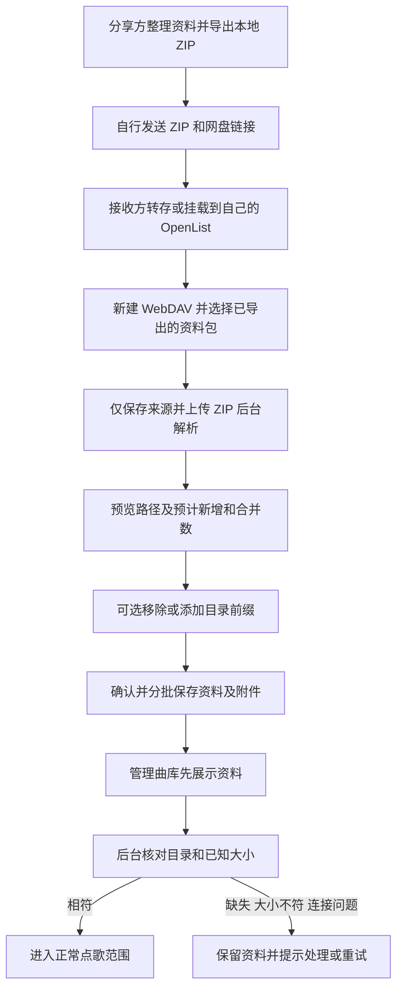

# 媒体库管理

管理页进入“添加与整理 → 歌曲来源”（`#/library/media`）。仅登录完成的管理员可操作；所有写请求沿用同源、会话和 CSRF 校验。当前支持媒体来源配置、解析方案绑定、本地目录文件名扫描及歌曲元数据保存。WebDAV 已支持后台文件名扫描；管理端可在线播放本地与 WebDAV 原始音视频；文件内嵌信息、聚会播放与兼容版本分别通过既有 Go 编排和计算服务提供，详见对应模块文档。

## 本地目录

在“添加媒体库”中选择“本地目录”，点击“选择文件夹”。桌面左侧提供媒体目录、下载目录、自定义挂载和已添加位置的快捷入口，窄屏使用“快速前往”选择框，并显示只读或无读取权限状态；可直接输入后端可见的绝对路径并回车跳转。新增媒体库优先打开可读的 `/media`，下载用途优先 `/downloads`，编辑时打开原目录。

点击文件夹整行进入，也可用键盘 Tab 聚焦后按 Enter 或空格进入；面包屑和上一级按钮用于返回。无需勾选或额外点击“打开”，底部始终显示当前完整路径，通过“使用当前文件夹”确认；空目录也可直接确认。名称筛选覆盖当前目录的所有可读子文件夹，筛选后再按每页 100 项分页。读取失败保留已浏览位置及输入，可重试或返回常用位置。名称留空时按文件夹名称生成；文件名识别直接展示在来源表单中，定时扫描位于“更多设置”。

保存时解析真实路径、检查目录存在且可读，并实际尝试列出目录；无效路径返回 400。空目录可添加，符号链接按真实路径存储，同一真实目录不重复添加。不浏览用户电脑，也不自动挂载 NAS、修改权限或写入原件。选择器的可写状态仅供提示，下载用途仍在保存时实际探测写入。保存时可读不代表之后持续在线，也不代表每个媒体文件均可读取或播放。

Docker 中路径指后端容器内路径。宿主目录需先由部署者挂载，例如在应用 Compose override 中添加：

```yaml
services:
  singverse-go-backend:
    volumes:
      - /your/nas/karaoke:/media/karaoke:ro
```

合并启动：`docker compose --project-directory . -f infra/docker/compose/compose.app.yaml -f compose.media.yaml up -d --build --wait`（将上述配置保存为本地 `compose.media.yaml`，真实路径不要提交）。随后表单填 `/media/karaoke`。默认 Compose 不挂载任意宿主目录，停止时保留数据卷。

## WebDAV

“添加 WebDAV”为独立表单：名称、HTTP(S) 目录地址、解析方案、可选用户名与密码/应用密码。不接受 URL 内嵌凭据、查询或 fragment。目录地址标准化为末尾带 `/`，同一地址不能重复添加。保存时校验配置；默认“保存并扫描”将扫描请求持久化，由 Go 在后台连接目录，也可选择“仅保存”。配置状态不代表持续在线，扫描结果单独展示。HTTP 地址可配置，建议使用 HTTPS；没有关闭证书验证的开关。

密码使用现有主密钥 AES-256-GCM 加密，独立 AAD 为 `singverse:webdav:v1`，密文格式仍是 `v1:<base64 nonce>:<base64 ciphertext+tag>`。接口只返回 `passwordConfigured`，不返回明文或密文。编辑时省略/null 密码保留旧值，空字符串清除；改变地址或用户名且已有密码时须重新输入或明确清除，避免将旧凭据用于新的目标。密码丢失不能从页面找回。

主密钥路径与备份方式沿用[认证说明](authentication.md)，现在也保护 WebDAV 凭据。有远端密码时，主密钥缺失或不匹配会使服务启动失败，不能通过重新生成密钥静默丢失凭据。数据库与匹配的主密钥须配套备份。认证恢复不会清除媒体来源，不能替代遗失的 WebDAV 凭据密钥恢复。

## 数据和接口

SQLite / MySQL 使用 `202611070001_initial_schema.sql` 从空库初始化，由 dbmate 启动流程应用。`media_source` 保存 UUID、名称、类型、位置、位置摘要唯一键、用户名、密码密文及 UTC 创建/更新时间，不存媒体文件；`parser_profile_id` 默认绑定 `default`。`media_song` 保存相对路径、文件大小/修改时间、解析方案与配置修订号、命中规则及解析结果 JSON，空库索引由扫描写入。所有业务 SQL 通过 模块内嵌 SQL 执行。位置唯一范围是来源类型与标准化位置，不按用户名区分。

契约见 [OpenAPI](../contracts/openapi/singverse.openapi.json)：

| 方法 | 路径 | 行为 |
|---|---|---|
| GET | `/api/v1/media-sources` | `page` 从 0 开始，默认 0；`size` 默认 20、最大 100。按创建时间倒序、ID 升序 |
| POST | `/api/v1/media-sources` | 创建，201 与 Location |
| GET | `/api/v1/media-sources/{id}` | 查询单项，200 |
| PUT | `/api/v1/media-sources/{id}` | 更新，200；类型不能改变，本地目录重新检查 |
| DELETE | `/api/v1/media-sources/{id}` | 移除配置及其歌曲索引，204；绝不删除原件或向远端发送 DELETE |
| POST | `/api/v1/media-sources/{id}/scan` | 同步扫描本地目录，成功后原子更新歌曲索引；WebDAV 请使用后台任务接口 |
| GET | `/api/v1/media-sources/{id}/songs` | 分页读取已保存歌曲数据，`page/size` 规则同媒体来源，按稳定 ID 升序 |

无效参数 400、未认证 401、CSRF/来源拒绝 403、不存在 404、重复位置 409。错误使用 Problem Details。列表带 `items/page/size/totalElements`，时间是 ISO 8601 UTC。列表中“已配置”仅指数据库配置存在。

验证入口：`make frontend-check`、`make go-backend-test`、`make web-check`；MySQL 实例准备好后运行 `make db-mysql-check`，继承的 HTTP 用例同样覆盖媒体来源。浏览器和临时 SQLite 测试不能替代真实 NAS 挂载、微信或 WebDAV 提供者验收。

## 来源内的文件名识别

“歌曲来源”包含“来源与扫描”和“文件名识别”两个内部入口，自定义规则收进识别方案的高级配置。来源卡片展示当前方案并可直接进入编辑；添加或编辑来源时，通过“试验与调整”在同一个窗口检测文件名、选择/复制/保存方案以及维护自定义规则，来源表单和凭据仅在组件内存中保留。

选择方案后须点“使用此方案并返回”，再保存来源才更换绑定。共享方案/规则的保存会影响所有引用来源的后续扫描，页面明确提示；如只调整一个来源，应先复制方案。关闭、离开或刷新保护来源、方案和规则的未保存输入，版本冲突保留各自草稿。旧方案与规则地址及指定方案查询继续兼容，详见[文件名识别说明](filename-rules.md)。

## 解析方案与本地扫描

新增/编辑本地目录及 WebDAV 都要在表单选择完整的已保存方案，按其中启用成员的顺序解析，第一条完整命中生效；不单独绑定某条规则。接口字段为 `parserProfileId`：兼容旧客户端，创建时省略/null 使用 `default`，更新时省略/null 保留原绑定；明确提供的 ID 必须存在。方案被来源引用时禁止删除，返回 409 并列出来源名称；改名和成员修改允许，下一次扫描才生效，已有歌曲数据不会自动重写。绑定/删除检查使用数据库事务及配置单例行的数据库写锁协调。

本地目录默认“保存并扫描”，创建后由后台入库任务递归读取文件名和文件属性，也可仅保存后从更多操作手动扫描。扫描固定使用开始时解析方案的不可变快照；配置了可用 compute 时通过既有只读标签能力补充文件信息；没有 compute 时仍可按文件名建立索引，不跟随文件或目录符号链接。支持 mkv、mp4、mpg、mpeg、avi、ts、vob、mov、wmv（大小写兼容），不支持的文件跳过。按方案提取歌名、歌手、语种、版本、歌曲编号及标签等证据，并记录命中规则、置信度和复核状态；空方案或未匹配不调用其他方案兜底，仍保存为需复核记录。

扫描成功后在单个事务内替换该来源的索引：重复扫描不会重复入库，相同来源与相对路径保持稳定 ID，已不存在文件的索引会被移除。目录离线、读取失败、超限或保存失败时保留原索引；已有索引的来源本次扫描突然发现零媒体文件时也返回 409 并保留数据，需先核实挂载与文件类型，避免空挂载被当作全删；扫描期间来源或解析配置变更时返回 409，需重新扫描。同一进程内同来源重复扫描返回 409；跨进程通过来源更新时间校验避免旧扫描覆盖新结果。原始歌曲文件不会被修改或删除。

本地目录是有界同步扫描，单次上限 2000 个媒体文件、20000 个访问条目、32 层目录、30 秒遍历/解析预算，超限返回 400 且不提交部分数据；浏览器扫描请求超时为 60 秒，后端入库时间另计。本地大型曲库需拆分来源，本地新增持久化入库启动任务，后台调用原有有界扫描；不提供逐文件实时进度或取消；WebDAV 后台任务见下文。扫描完成后保留在媒体库页面，卡片显示本次结果；点击“查看歌曲”进入该来源的筛选列表。歌曲管理集中展示所有已入库歌曲，可按媒体来源、文件名及复核状态筛选，查看歌名、歌手、原相对路径、语种及解析详情。目录可读或解析完整均不代表歌曲能播放。

## 歌曲管理

入口 `#/library/songs`，位于曲库菜单的媒体库管理下方。读取扫描写入的同一份 `media_song` 索引，不复制歌曲文件，也不要求先打开某个来源。初始化脚本直接定义复核标志与查询索引，扫描写入复核状态。

`GET /api/v1/media-songs` 仅允许登录管理员访问，采用 `page`/`size` 分页，默认 20、最大 100。可选 `sourceId` 限定来源，`q` 为文件相对路径的字面子串搜索，`status` 为 `ALL`、`REVIEW` 或 `MATCHED`；搜索中的 `%`、`_` 不作为通配符。列表按扫描时间倒序、稳定 ID 升序，同一事务读取列表与总数；歌曲附带当前媒体来源名称。来源已移除时，文件入口解除绑定；正式歌曲资料仍可在“歌曲与版本”查看。

歌曲与版本页使用正式资料文档；按文件管理保留筛选、审核与原片试听。文件失联保留资料，移除来源默认解除位置绑定，屏蔽歌曲是独立的本机决定。媒体原件保持只读。

## OpenList / WebDAV 后台扫描

OpenList 地址示例为 `https://nas.example/dav/歌曲目录/`，需从 Go 服务所在网络可达。使用 OpenList 账号及其密码，账号必须开启 WebDAV 读取权限；不需要管理或删除权限。可参考 [OpenList 官方 WebDAV 配置](https://doc.oplist.org/guide/advanced/webdav)。默认“保存并扫描”，也可仅保存后从更多操作扫描。目录扫描阶段只用 `Depth: 1` 的 `PROPFIND` 逐目录枚举，按方案解析 MKV、MP4 等媒体文件名，不向视频发送 GET/HEAD，不下载、不探测、不修改原文件，也不会自动触发外部元数据刮削。

请求路径统一转换成 UTF-8 百分号编码的 ASCII URI，兼容包含中文、空格、百分号与加号的目录；返回的 href 只解码一次，仍拒绝跨来源和越界路径。

目录响应附带的大小与修改时间会被保存；缺失或无效时为 null，页面显示“远端未提供”，不会为了补齐属性访问媒体文件。补充元数据指纹兼容空属性；已登记文件沿用媒体 UUID；重命名可通过明确位置绑定保留身份，缺失文件标记失联并保留资料。缺少文件属性时，无法据此识别同路径媒体内容是否被替换。

后台任务单来源最多 100000 首媒体、1000000 个子条目、128 层目录，最长两小时；连接超时 10 秒，每个目录请求（含响应读取与该目录分批处理）最长 60 秒、响应最多 64 MiB。最多同时执行两个任务，另有 32 个排队位置，同一来源不能重复创建活动任务。大量单层条目或慢速网盘可能先触及单目录预算，应拆分来源。遇到 401/403 检查账号及权限；404 检查 `/dav/` 及挂载路径；重定向不会自动跟随，请填写最终地址。正常校验证书，私有 CA 需由部署者配置 Go 服务所在系统的证书信任。

任务状态为 QUEUED、RUNNING、SUCCEEDED、FAILED、CANCELLED、INTERRUPTED；阶段为 SCANNING、COMMITTING。页面每两秒查询已发现目录、条目、歌曲和复核数量，扫描前不知道总量，不显示百分比。离开页面后台继续，刷新或返回会查询最近任务；完成后提供“查看歌曲”，不会强制跳页。提交索引阶段不能取消，其余活动阶段可请求取消。

SQLite/MySQL 初始化脚本直接允许文件属性为空，并定义 `media_scan_task`、`media_scan_directory`、`media_scan_song`。目录待办及解析结果分批持久化，运行内存不随整库解析结果增长；完成后使用事务及 INSERT SELECT 替换正式索引，扫描期间旧索引仍可查询。全部成功才提交，失败、超限、取消、来源/方案变化或突然空扫描均保留旧索引。独立扫描任务在重启后标记中断；由“保存并扫描”创建的持久入库请求会自动重新启动目录扫描。终态任务每小时清理，保留七天且每个来源至少保留最近一条。

后台接口均受管理员会话保护，POST 同时要求 CSRF：

| 方法 | 路径 | 行为 |
|---|---|---|
| POST | `/api/v1/media-sources/{id}/scan-tasks` | 创建 WebDAV 任务，202 与 Location；重复活动任务/队列满返回 409 |
| GET | `/api/v1/media-sources/{id}/scan-tasks/latest` | 最近任务，无任务返回 204 |
| GET | `/api/v1/media-sources/{id}/scan-tasks/{taskId}` | 查询持久化状态；任务必须属于该来源 |
| POST | `/api/v1/media-sources/{id}/scan-tasks/{taskId}/cancel` | 请求取消；已结束或正在提交返回 409 |

模拟 WebDAV 测试覆盖目录读取、认证、编码、错误与十万首暂存导入，不能代替实际 OpenList 与网盘供应商验收。真实验收需核对目录/歌曲数量，并通过访问日志确认扫描期间只有 PROPFIND，没有媒体 GET/HEAD 请求；日志不得公开凭据。

## 元数据补全

扫描索引进入歌曲管理后，可对单曲、选中歌曲或全库进行平台元数据刮削并审核候选。确认直接更新正式资料，重扫与文件属性变化不会撤销人工决定；文件变化只使相关媒体技术证据待重新核验，原媒体只读。平台自动写入默认关闭，参见[元数据刮削](metadata-scraping.md)。

歌曲列表使用独立搜索区、分页表格及可选每页条数；媒体库改为卡片展示，来源 API 保留名称/地址、类型、方案筛选能力，查询使用 ID 分页后延迟关联和筛选排序联合索引。深分页成本与包含搜索边界见[列表查询说明](library-search.md)。

媒体来源添加/编辑支持定时扫描开关及标准五段 cron（上海时区）；配置与下次触发持久化，同来源扫描中跳过，停机遗漏不逐次补跑。使用及 API 字段、调度限制见[定时扫描](media-scan-schedule.md)。


## 媒体库与本地目录选择

管理端“媒体库”以卡片呈现来源，统一添加入口；定时扫描、解析方案收进“更多设置”。本地文件夹通过 `GET /api/v1/media-sources/local-directories?path=...&page=0` 浏览选择，WebDAV 仍填写地址。名称在前端留空时按文件夹名生成，API 的 name 仍为必填。

目录接口仅管理员会话可用，范围与已有本地来源保存相同：服务进程有权读取的目录，不改变权限或挂载。空 path 列出文件系统根目录；绝对路径返回规范化 path、parent、items（name/path）、hasMore。parent 为 null 表示根目录列表，为空字符串表示返回该列表。仅列可读子目录，略过符号链接，不读文件内容；按目录名排序，每页固定 100 条，page 从 0 开始且不超过 10000。路径无效、不存在或无法列目录返回 400，未登录返回 401。Docker 中仅能看到容器目录，NAS 歌曲目录须预先只读挂载，不能通过浏览器选择未挂载的宿主机目录。


## 管理端在线播放

歌曲列表行内操作统一为按钮，新增“在线播放”，在带原生控件的视频弹窗中播放当前歌曲。关闭弹窗或离开页面移除 video 元素以停止读取；错误时可重新加载。

`GET /api/v1/media-songs/{id}/video` 与 HEAD 复用管理员 Cookie 会话，未登录返回 401，不提供公开媒体 URL。支持单段 Range（起止、开放结束、后缀范围），本地响应 200/206/416 和 Content-Length/Content-Range；非法范围或多范围返回 400。所有流响应禁止缓存。本地解析真实路径并限制在来源目录内，失效文件或越界符号链接返回 404。

WebDAV 使用保存的地址和加密凭据在服务端发起 GET/HEAD，转发 Range，不把凭据或远端地址返回浏览器。采用 10 秒连接、30 秒读取空闲超时，流式传输，不落盘、不完整缓冲；连接随响应结束/客户端断开清理。上游忽略 Range 时保持 200，拖动能力取决于上游；不跟随 3xx（返回 502），需要支持直接读取的 WebDAV 服务，OpenList 等返回下载跳转的配置需调整，否则暂不能播放。认证/读取错误返回不含远端细节的 502。

只播放原始音视频，不调用 Python、不转码、不创建队列或电视会话。浏览器能否解码取决于容器与视频/音频编码，MP4/WebM 也不保证所有编码都能播放，MKV/AVI 等可能不可播放。Nginx 对视频接口关闭 proxy_buffering/proxy_cache，避免视频临时文件与额外等待；代理读取空闲超时为 60 秒。真实 NAS、WebDAV 提供者、浏览器编码兼容性仍须单独验收。


## 音频文件扫描与在线播放

本地目录与 WebDAV 文件名扫描统一支持 MP3、FLAC、WAV、M4A、AAC、OGG、OGA、Opus、WMA、AIF、AIFF、APE，扩展名不区分大小写，沿用现有解析方案提取歌名和歌手。WebDAV 目录扫描只建立文件名索引，不读取音频内容或内嵌标签；本地扫描通过可用 compute 读取标签。新增格式需重新扫描才会进入歌曲列表，现有扫描数量限制不变。

“在线播放”按扩展名选择音频/视频控件。音频复用已鉴权的 GET/HEAD `/api/v1/media-songs/{id}/video`（为兼容保留原路径），返回 audio/* 媒体类型，沿用 Range、后端 WebDAV 代理、凭据保护与关闭停止加载。音频失败可重试，切换或关闭时移除旧媒体元素。不提供转码，扩展名可入库不保证浏览器能解码；WMA、APE 等通常需要其他播放器。WebDAV 下载重定向限制不变。

本地音视频扫描新增只读标签工作器：Go通过内部认证HTTP请求singverse-compute，所有FFmpeg/ffprobe均在计算服务执行，不转码或写原件。计算服务开发/测试需Python3与FFmpeg，独立计算镜像已包含；Go不安装这些工具；运行配置见后端README。文件标签作为自动证据填补空缺，人工确认字段受保护；WebDAV目录扫描不下载内容。SQLite/MySQL 初始化脚本直接定义 embedded_tags_json。

## WebDAV 增量内嵌元数据（2026-10-31）

WebDAV 现支持显式启用后台内嵌元数据提取；未启用来源保持仅目录扫描。索引按路径增量合并、两次缺失确认下架、缓存保留 30 天，同路径的完整/空/部分/超限结果不因重扫重新读取。读取标签、技术信息、封面和歌词使用 Go 授权的有界 Range，由 compute 执行，含共享限流、单文件上限、受控跳转和版本检查。完整行为、API、配置及验证入口见[Go 模块文档](../services/singverse-go-backend/README.md#webdav-增量索引与内嵌元数据)与[compute 文档](../services/singverse-compute/README.md#webdav-远程内嵌元数据)。此前“仅 PROPFIND、不读取内容”的描述仅适用于目录扫描阶段及未启用内容提取的来源。

“整理与分享”默认只展示歌曲信息、分享曲库、导入曲库。完善信息一键开始/暂停，文件保存和分包在后台自动处理；分享等待时只显示“正在准备”，完成后下载。访问组、代理、样本检查、增量与单独分包下载收进默认折叠的“高级选项”。不要求用户理解读取预算、刷新代次或保存队列。

十万首分享由后台固定快照和有界分包完成，关闭窗口后继续，准备好后点击“下载分享包”。接收方将媒体挂载到自己的 OpenList 并添加对应 WebDAV 来源，选择收到的整套 ZIP，上传完成后后台解析；核对自己的根目录及相对路径，确认后才合并资料，无需解压或挑分包。服务按顺序流式处理内部每包，整套最多 8 GiB、每个分包仍最多 32 MiB/5000 首；上传中断需重新选择文件，后台阶段中断可从任务检查点接续。上传尚未完成时保持窗口打开；上传完成后允许关闭页面，从任务中心返回预览和结果。后台解析、分批导入和媒体核验使用持久检查点恢复，失败后保留已完成资料。


本地与 WebDAV 的正式元数据统一同步至 `WEBDAV_METADATA_PATH/library/{sourceId}/{songId}/`，包括 STRM、NFO、JSON，以及可用的封面和歌词。采用刮削候选、人工编辑、歌手订正或内嵌提取完成后自动更新；数据库仍用于查询和持久待办，原媒体及旁边目录不写入。共享快照直接从数据库及持久附件生成，包含已保存的人工/平台信息；不依赖 JSON/NFO/STRM 生成成功，后续采用的信息优先于共享记录。

每包上限调整为 **5000 首**；附件较大时仍按 32 MiB 提前分包，不能把有大量封面的任意 5000 首保证塞进一包。文件保存与重试自动在后台完成，详细状态仅在高级选项中显示。未就绪的封面后台补齐，不阻塞歌名等正文保存和分享。已经下载的快照不会自动改变，编辑后需要生成新包或增量包。分享 STRM 始终使用占位根地址，不导出本机绝对路径。

后台提取已取消每日累计首数和字节额度，日读取统计仅供查看。手动刷新优先于普通后台任务，仍遵守请求间隔、单文件读取上限及网盘异常冷却。

## 媒体入库、资料合并与分享（2026-11-10）

普通来源添加主操作为“保存并扫描”，另有“仅保存”。新 API 可选 `startScan` 控制持久后台入库，旧客户端省略时继续只保存。普通编辑不自动扫描；更改文件名识别方案后需重新扫描。WebDAV 的“自动读取文件内的歌曲信息”默认关闭，勾选后先索引目录，再按既有预算和读取能力逐首完善。本地继续复用标签读取能力；无 compute 不影响共享资料导入和查看。


来源卡片由服务端统计已入库、具备歌名和歌手、正在处理、信息不足、待核验路径及媒体问题。处理完成不代表信息完整；文件无标签、格式不支持、分段读取不兼容仍按原有提取状态解释。目录核验只验证该路径可列出及已知大小相符，不能推断 Range 读取、浏览器解码或实际播放成功。

新建 WebDAV 时，可在“入库方式”勾选“从已导出的资料包入库”，填写自己的 WebDAV 媒体根目录并选择已导出的完整 ZIP，点击“保存并导入资料包”。页面先保存来源，再自动上传已选文件；不创建全量扫描任务、不启用文件内容提取，定时扫描也先关闭，导入完成后可在编辑媒体库时开启。顶部“导入资料包”直接进入同一流程。

上传后在后台解析资料包，显示包内路径与自己的组合地址，确认后保存资料和附件，再核对目录及已知大小。导入期间禁用扫描与提取入口；已有资料直接复用，不因添加来源而重新解析整批远端媒体。上传未完成时保持页面打开，页面会保护关闭弹窗、站内切页和刷新；上传失败可在同一来源上重试已选文件，无需重新新建媒体库。来源保存失败时保留所选文件，保存成功后才上传；来源列表刷新不会阻塞上传。上传完成后可离开页面，从任务中心返回预览、确认和核验结果。



v4 包内保存稳定对象 UUID，位置使用逻辑根与相对路径，不按同名歌曲模糊绑定。目录前缀仅调整精确匹配的路径，其余目录保留；找不到前缀或调整后路径重合时整次回滚。根地址与相对路径通过 URL 路径编码组合，中文、空格、百分号等只编码一次。系统播放仍经过 Go 鉴权代理，服务端使用接收方配置；本机 STRM 使用自己的地址，再次导出的 STRM 使用占位根。包不含媒体、来源凭据、本机路径或临时下载直链。

默认导出 Metadata Schema 1.0 / v4 完整包，包含稳定对象标识、正式字段、字段来源、关联对象与二进制原始附件。资料语义与 ZIP 容器分别版本化，记录与清单有完整性校验。附件去重并拆成不超过 16 MiB 的块，保留每片 32 MiB 边界。v2/v3 仍可导入；v2 不推断后续更新系列。旧空白字段忽略，v4 明确清空可随已跟随来源更新；本机 SET/CLEAR、上传图片和独立采用结果保留。已扫描文件可补入资料，重复导入不重复建歌；基线只在全包提交后推进，旧版本和同修订不同内容被拒绝。完整规则见[v4 资料包](../contracts/metadata/package-v4.md)。

后台任务状态依次为 `PARSING → PREVIEW → QUEUED/RUNNING → VERIFYING → SUCCEEDED`，错误或取消保留已提交内容。每批最多 100 首，入库与结果计数同事务提交；重启后可续跑已确认任务，失败/取消后可继续，核验重试只处理未通过项目。解析只接收一份完整 ZIP 或一个兼容分片，整次上限 10 万首，保留 8 GiB 总量与 32 MiB/5000 首每片限制。终态导入任务及上传暂存保留 30 天，正式资料独立保留。

高级选项“重新绑定自己的媒体目录”保留来源和歌曲 ID、资料、本地订正，单独更新地址/账号/密码并重置媒体核验；存在其他活动导入时须先完成或取消。普通改来源地址解除旧位置关系并保留资料；迁移曲库应使用重新绑定入口，以同时保留绑定和核验工作流。

数据库保存共享记录、版本基线及本地正式信息，封面和歌词存于 `WEBDAV_METADATA_PATH`，新上传封面位于其 `uploads/`；旧缓存上传路径继续兼容读取。自动生成的 JSON/NFO/STRM 失败会后台重试，正式资料照常查询。文件失联保留资料，连接失败不会当作删除。已写入持久资料记录或导入共享资料的歌曲，在媒体归档超过 30 天后继续保留正式信息、本地订正和媒体身份；30 天清理仅回收没有正式资料的旧资源与临时任务。分享包只用于资料复用；系统恢复还需配套备份数据库、主密钥、持久附件和其他仍在使用的历史缓存。

新增接口（写入均需管理员会话、同源与 CSRF）：

| 方法 | 来源下路径 | 行为 |
|---|---|---|
| GET / POST | `ingest-tasks/latest` / `ingest-tasks` | 查询或创建持久入库请求 |
| POST | `embedded-metadata/import-jobs` | 上传完成返回 202，后台解析 |
| GET | `embedded-metadata/import-jobs/latest` / `.../{jobId}` | 返回可恢复任务和路径样本 |
| PUT | `.../{jobId}/mapping` | 预览阶段调整精确目录前缀 |
| POST | `.../{jobId}/apply`、`cancel`、`retry` | 确认、取消、继续或重新核验 |
| GET | `.../{jobId}/differences?cursor=0` | 每页 100 项差异和媒体问题 |
| POST | `rebind` | 保留资料并重新绑定及核验 |

旧同步导入接口继续兼容，推荐使用有预览和后台恢复的新入口。Go 负责授权、编排和唯一业务库写入，compute 仅执行已授权的媒体内容提取。

来源详情的高级设置提供“诊断目录与分段读取”（`POST /api/v1/media-sources/{id}/diagnostics`）：先检查列目录，再对一首已入库歌曲发送 `Range: bytes=0-0`。分别提示忽略 Range、下载跳转、权限不足、限流、文件缺失和连接失败；忽略 Range 时停止读取，不下载完整媒体，也不把诊断成功当作编码可播放。


## 正式资料、版本与资源（2026-11-11）

`#/library/songs` 按 SONG 展示，详情分页列出 VARIANT 和 MEDIA；原文件审核入口为 `#/library/songs/files`。来源结果分别统计歌曲数、版本数、文件数、资料缺口和待核验位置；统计由索引列与关系表聚合，不在轮询时解析整库文档。初始旧数据按“一文件一版本”登记，保留媒体 ID，不合并同名歌。

当前正式字段、SET/CLEAR/RESET、证据与合并基线由 `internal/metastore` 统一保存。媒体时长与平台参考时长分开；导入歌词和封面通过同一正式入口供管理、TV、H5 和手机读取。无 compute、平台离线或媒体失联时，已保存资料继续可用。完整规则、字段字典、公开 JSON Schema、兼容样例与独立校验器见[元数据存储标准 1.0](../contracts/metadata/README.md)。

显式“重新绑定位置”保留 SONG / VARIANT / MEDIA UUID，后台核验接收方目录。确认文件内容已被替换时登记新 MEDIA，原记录保留为 REPLACED；单纯大小或 mtime 改变只重新核验，不推断新内容。拆为新版本不自动复制旧歌词时间轴。共享资料提出的分组如会隐藏已有人工订正，保留本机分组并显示关联差异。

正式附件位于 `WEBDAV_METADATA_PATH/assets/`，资源 ID 是原始字节 SHA-256。32 MiB 合法原图可以跨保存、清缓存和 v4 分享完整往返；缩略图是独立缓存。当前引用与活动任务租约阻止清理，未引用附件有七天宽限。JSON/NFO/STRM 是后台衍生物，失败不影响正式资料查询；完整系统恢复须另备份数据库、密钥和持久目录。
