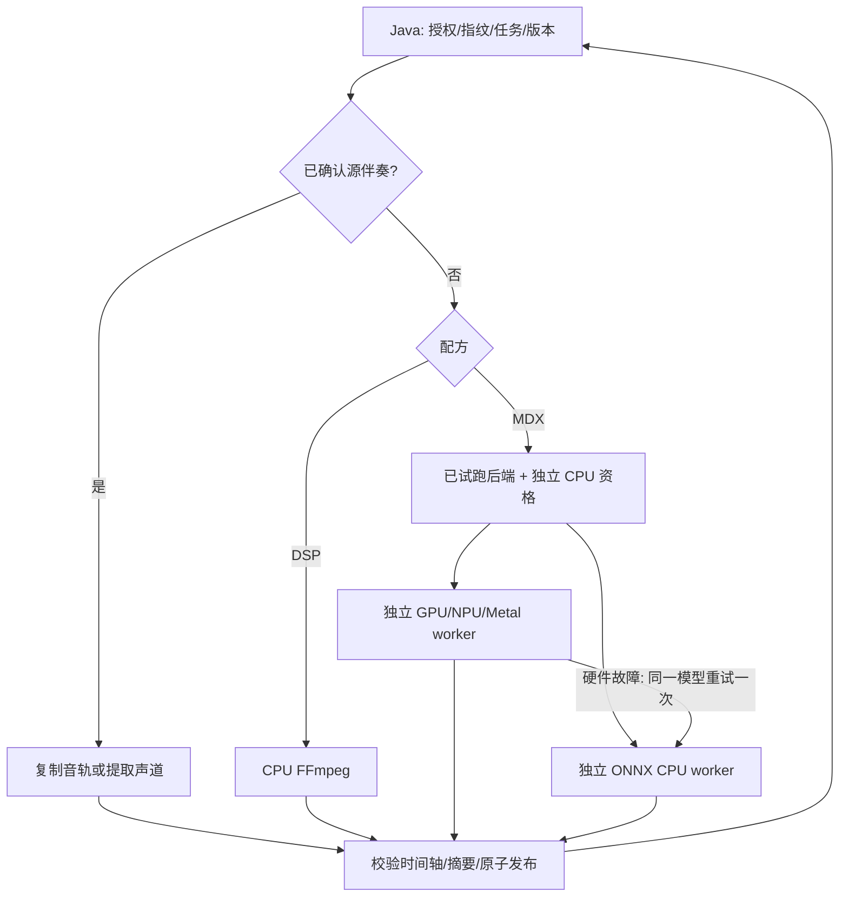

# 跨平台快速伴奏提取

更新：2026-11-09。当前交付管理端单曲、批量与短片试听；点歌后即时生成和边生成边播放尚未接入。原始媒体只读，Java 负责授权、任务与数据库，compute 负责处理；没有新增 Redis、消息队列或外部服务。本次实际检查与限制见[验证记录](VERIFICATION.separation-2026-11-09.md)。

## 已实现的产品行为

管理端“伴奏处理”及歌曲的“原唱与伴奏”详情支持：

1. **复用源伴奏**：优先使用当前媒体指纹下已确认的伴奏音轨；也可试听后明确选择整条音轨、左声道或右声道。兼容的整曲 AAC／FLAC 直接复制码流，时间轴不匹配时重新编码。声道提取输出双单声道。仅有两条音轨不代表已经找到伴奏。
2. **极速档 `DSP_FAST`**：FFmpeg 计算 `0.5×(L−R)`，相同结果写入左右声道。无需模型、Torch 或 GPU。居中的人声和乐器都会被削弱；混响、和声可能残留。单声道、左右相同和处理后近静音会明确失败，不发布静音伴奏。不混回原始高低频。
3. **干净档 `AI_CLEAN`**：固定 `UVR_MDXNET_9482`，共享 NumPy 频谱处理与分段重建，选择通过试跑的推理后端。此名称表示处理路线，不保证所有歌曲残唱都少于 DSP。
4. **高级档 `LEGACY_DEMUCS`**：保留 HTDemucs 与既有设备适配，增加 CPU／CUDA／MPS 常驻进程复用。旧 `FAST` 仍是音轨快速识别任务，与极速档无关。

每档可生成中部 **12 秒试听**（短曲取全长）、整曲 AAC 192k 或 FLAC。试听位置为 `(全长−试听长度)×0.35`，不保证覆盖主歌。FLAC 从本次浮点分离结果编码，不把已生成 AAC 转为“无损母版”；算法本身仍可能有损。旧高级档保持其原有 PCM 分轨精度，不承诺浮点母版。

新节点初始选择极速档，管理员可先试听再明确选择 AI 档；不会因为合成试跑成功就把未做真实歌曲质量验收的新模型自动升级为产品默认。

每次配方、格式与试听各自保存为独立版本，生成失败不覆盖原成功版本。首次完整 AAC 可成为当前伴奏；后续版本需试听后手动切换，下一次播放生效。试听与 FLAC 导出不能设为 TV 当前伴奏。批量支持准备、确认、取消、重试和逐曲发布；继承后台任务入口与实时视频播放优先机制。

## 统一执行与 CPU 隔离



设备枚举、运行时存在、模型试跑合格是三个状态；只有 `AVAILABLE` 可被自动选择。模型试跑验证有限值、时间轴与实际算子执行位置；加速后端还与 CPU 参考比较，合成 8 秒音频相对 L2 误差上限 2%。**这是数值资格，不是真实歌曲音质验收。**

资格绑定后端、模型 SHA、频谱配方、处理精度策略、Python／运行库、设备及驱动环境指纹。CUDA 与 TensorRT、OpenVINO GPU 与 CPU 分别试跑。ORT profiling 必须确认请求的 EP 实际执行节点，不能只看到 provider 名称就宣称 GPU 可用。混合图记录实际分区；OpenVINO 显式选择 GPU 或 CPU，不使用隐式 AUTO。

`AI_CLEAN` 必须先有已安装且试跑合格的 **CPU 专用 ONNX Runtime**。CPU worker 不导入 Torch、CUDA、ROCm 或 GPU 驱动；与加速 worker 使用不同 Python 环境，避免互相覆盖 ORT 包。服务基础进程通过子进程探测运行时，GPU 导入失败不会导致服务启动失败。DSP 不依赖这些环境。

加速器初始化、驱动、算子、显存／worker 内存、崩溃或超时故障，清理未完成输出，从同一解码 PCM、同一 MDX 配方在 CPU 重试一次；原后端熔断 10 分钟。选定设备已失去资格时，可按开启的 `cpuFallback` 策略直接选择合格 CPU，记录原因。源文件、回源认证、磁盘错误、取消不触发计算重试。CPU 再失败就结束任务。**干净档不会自动改为 DSP。**

高级档的 CPU worker 可用同一独立 CPU 环境追加 CPU 专用 Demucs。所有 legacy 容器变体都安装此路径；原生节点使用下方 `--legacy`。CPU 环境没有 Demucs 时，高级档 CPU 不授予资格，MDX 与 DSP 仍可运行。旧 RKNN 入口是 MDX，不能失败后换成 HTDemucs；要获得同模型 CPU 回退，应使用 `AI_CLEAN`。

## 安装与首次使用

从仓库根目录执行，使用项目 Python 3.12，不修改全局环境：

```sh
make compute-setup PYTHON=python3.12
make compute-separation-cpu-setup
# 可选：高级档独立 CPU 兼容路径，体积明显大于最小 ONNX 环境。
services/singverse-compute/.venv/bin/python scripts/setup-separation-runtime.py --legacy
# 固定摘要模型下载；也可在节点模型页面下载或导入仅含 ONNX 的 ZIP。
services/singverse-compute/.venv/bin/python scripts/setup-uvr-model.py
```

在启动 compute 的进程环境配置（仓库根 `.env` 不会自动被原生 Python 或 Spring Boot 加载）：

```sh
export COMPUTE_AUDIO_CPU_PYTHON="$PWD/services/singverse-compute/.venv-audio-cpu/bin/python"
export COMPUTE_AUDIO_MODEL_REPO="$PWD/.tools/demucs-htdemucs"
export COMPUTE_AUDIO_THREADS=0
# 如有独立 GPU/Metal 环境，再设置此项；CPU 节点可不设置。
# export COMPUTE_AUDIO_ACCELERATOR_PYTHON=/absolute/path/to/.venv-audio-accelerator/bin/python
```

`COMPUTE_AUDIO_MODEL_REPO` 沿用原 HTDemucs 路径约定，MDX 位于其同级 `uvr-mdxnet-9482/UVR_MDXNET_9482.onnx`，并不要求同时安装 HTDemucs。还需按 compute README 配置凭据、缓存、FFmpeg 与 Java 连接。模型不在处理任务中隐式下载。重启后，后台自动检查已安装 MDX 的 CPU；加速设备在“性能节点配置”选择对应 MDX 试跑，不由安装包名称直接授予资格。

默认 base 容器含最小 CPU ORT，不声明 GPU 设备；高级 cpu/cuda/rocm/openvino/rknn 变体另含独立 CPU Torch。容器内运行中的加速 worker 故障可以回退；若 NVIDIA Container Toolkit 在**容器创建前**因宿主驱动失败，应用尚未启动，需使用不声明 GPU 的 CPU 部署入口，不能宣称 Python 可以自动修复容器启动失败。没有部署两套业务服务或在容器内挂载 Docker socket。

本地管理员 CLI 复用生产实现，可在不启动 HTTP 的情况下验证授权自备素材：

```sh
cd services/singverse-compute
.venv/bin/python -m singverse_compute.application.separation_cli \
  /absolute/path/input.flac /absolute/path/preview.m4a \
  --profile DSP_FAST --preview --cache /absolute/path/cli-cache
.venv/bin/python -m singverse_compute.application.separation_cli \
  /absolute/path/input.flac /absolute/path/clean.flac \
  --profile AI_CLEAN --backend cpu --qualify --format flac \
  --cache /absolute/path/cli-cache
```

输出路径必须不存在。CLI 只接受本地文件；HTTP 仍只接受 Java 授权的引用，不开放任意路径、命令、模型 URL 或滤镜。

## 六类平台的部署选择

极速档统一运行在 CPU。下表是已实现的适配顺序，**不是已证明的最快排名**。没有目标真机记录的后端保持待验收；模型的不同设备实现共享固定 MDX 配方和独立 CPU 回退。

| 平台 | 干净档优先试验 | 独立 CPU | 当前边界 |
|---|---|---|---|
| NVIDIA | ORT CUDA；再对照 TensorRT FP16 混合图 | ORT FP32；高级档 CPU Torch | 已实现 CUDA I/O Binding 与 TRT 缓存；本轮无 NVIDIA 真机新成绩 |
| RK3566 | DSP 优先；RKNN FP16 提前生成 | ARM64 ORT FP32 | 复用既有 RKNN manifest 校验；当前 MDX INT8 不自动上线；板端速度见历史记录 |
| Intel 核显 | OpenVINO 显式 GPU，比较设备选定精度 | ORT；可比较 OpenVINO CPU | QSV 可用不表示 AI GPU 可用；需 Intel 真机试跑 |
| AMD 核显 | 已验证 ROCm HTDemucs 保留；MDX MIGraphX EP 候选 | ORT FP32；CPU Torch | MIGraphX 必须安装匹配具体 ROCm/APU 的 ORT 构建；没有通用 ROCm EP 安装假设 |
| Apple M1–M5 | 原生 MLX；MPS 高级档保留，CoreML EP 试验 | ARM64 ORT；CPU Torch | 本轮 M2 的 MDX CPU/MLX/CoreML 合成资格和输出已验证；CoreML 为混合图；M1/M3/M4/M5 未验收 |
| 通用 CPU | 无加速器要求 | ORT FP32；可选 OpenVINO CPU、CPU Torch | SIMD 由实际 wheel、CPU 与算子决定，不宣称所有 CPU 支持 AVX-512 或 INT8 更快 |

### NVIDIA

```sh
services/singverse-compute/.venv/bin/python scripts/setup-separation-runtime.py \
  --directory services/singverse-compute/.venv-audio-cuda \
  --lock services/singverse-compute/requirements-separation-cuda.lock --role accelerator
```

运行库固定 ORT GPU 1.20.1、CUDA runtime 12.4、cuDNN 9.1，驱动由宿主机提供。`COMPUTE_AUDIO_ACCELERATOR_PYTHON` 指向此环境。GPU 模型 I/O 是 FP32，CUDA 不冒充 FP16 图；TRT 打开 FP16 并允许 CUDA／CPU 分区，记录 `fp16-preferred-mixed`。要试验 TensorRT 10.4，在另一 Linux x86_64 加速环境将 `--lock` 换成 `requirements-separation-tensorrt.lock`；该组合锁定 10.4.0 的 bindings/libs，需核对宿主驱动和 ORT 官方兼容矩阵，不是本轮 NVIDIA 验收成绩。`convert-separation-model.py --target tensorrt` 可先构建缓存，生产还须单独试跑。

### Intel

```sh
services/singverse-compute/.venv/bin/python scripts/setup-separation-runtime.py \
  --directory services/singverse-compute/.venv-audio-openvino \
  --lock services/singverse-compute/requirements-separation-openvino.lock --role accelerator
```

固定 OpenVINO 2025.4.0；Linux 主机需要与核显匹配的 OpenCL/Level Zero 驱动、render 设备权限。容器沿用现有 OpenVINO override。要对照 `openvino-cpu`，在 **CPU 环境**安装同一个 OpenVINO lock（含 CPU ORT），保持 CPU 不依赖 GPU 驱动。执行精度由设备选择，结果记录 `device-selected`，不能凭压缩权重声称所有算子 FP16。

### RK3566

模型转换与板端执行分开。沿用 `scripts/convert-rknn-audio.py`，Toolkit2/Lite2 2.3.2、固定 ONNX、转换摘要与板型 manifest；详见 compute README 与 RK3566 验证文档。将 CPU Python 指向 ARM64 CPU ORT 环境；加速 Python 指向 Lite2 环境。先试跑 CPU，再试跑干净档 RKNN。2 GiB 设备应依据实测 RSS 将 `COMPUTE_AUDIO_MEMORY_BYTES` 调整到可承受范围；不足时明确拒绝 AI，DSP 仍独立可用，不能因为有 NPU 就承诺实时。

### AMD

现有 `compute-audio-rocm-native-setup`／ROCm Docker override 仅覆盖已验证的具体 gfx1103 组合。高级档常驻 ROCm 继续可用，CPU interpreter 追加 CPU 专用 Demucs。MDX 适配 `MIGraphXExecutionProvider`，须部署与系统 ROCm、GPU 架构兼容的 ORT 构建并试跑；探测失败保持 CPU。ORT 新版本已移除旧 ROCm EP，不创建依赖它的生产接口。Windows DirectML 会话已按顺序执行、关闭 memory pattern；Windows 部署仍待真机验收。

### Apple Silicon

```sh
make compute-separation-mlx-setup
export COMPUTE_AUDIO_ACCELERATOR_PYTHON="$PWD/services/singverse-compute/.venv-audio-mlx/bin/python"
```

仅原生 macOS ARM64；Docker Desktop 的 Linux VM 不能代替 Metal。MLX 单独锁定 `mlx-audio-separator==0.1.20`、MLX 0.32.3、NumPy 2.2.6，与 CPU NumPy 1.26.4 环境隔离。直接加载固定 MDX ONNX 权重，仍使用本项目 NumPy STFT/ISTFT，避免混用包内不同后处理。统一内存也有布局转换与数组物化成本，记录主机→设备、执行、设备→主机时间，不能称为全链路零拷贝。

Core ML 通过 ORT CoreML EP 接入，并覆盖固定的 batch=1。可用 CPU ORT lock 另建 `.venv-audio-coreml`（`setup-separation-runtime.py --directory ... --role accelerator`），指向加速 interpreter 后试跑。M2 已完成合成资格与重复运行；profiling 显示 CoreML 与 CPU 混合图，不是纯 GPU/ANE。请求 CoreML 必须实际执行模型节点，失败回退同模型 CPU。选择 ALL 不代表全图 ANE；本轮没有原生 PyTorch→CoreML、ANE 定位、demucs-mlx 同权重对照或 M1–M5 全系列性能验收。是否继续投入这些候选，由真实歌曲对照决定。

## 锁定依赖与模型

| 用途 | 文件／固定内容 |
|---|---|
| 服务基础环境 | `requirements.lock`，不新增 GPU 依赖 |
| CPU MDX | `requirements-separation-cpu.lock`：ORT 1.20.1、NumPy 1.26.4、SoundFile 0.13.1 |
| CUDA MDX | `requirements-separation-cuda.lock`，独立于 CPU ORT |
| TensorRT 实验 | `requirements-separation-tensorrt.lock`：CUDA 环境加 TensorRT 10.4.0 |
| OpenVINO | `requirements-separation-openvino.lock`：2025.4.0 |
| Apple | `requirements-separation-mlx.lock` 完整冻结；`.in` 保存直接依赖 |
| 离线转换 | `requirements-separation-tools.lock`：CPU ORT + ONNX 1.17.0 + OpenVINO |
| 高级档 | 现有 `requirements-audio*.lock`，不顺带升级 Torch／Demucs |

模型 `UVR_MDXNET_9482.onnx`：29,704,738 字节，SHA-256 `9d78f8566fa8198065214ab628be1de966a500c57786695aa4b13e2b27a7727d`。配方：44100Hz stereo、FFT4096、hop1024、2048 bins、256 frames、trim2048，去除最低三个 bin，预测人声后从源信号相减；不把其它 MDX 模型套进此参数。模型许可、代码许可、训练数据使用条件分别审查；缓存不包含用户原件。

## 转换、量化与质量门槛

```sh
services/singverse-compute/.venv/bin/python scripts/setup-separation-runtime.py \
  --directory services/singverse-compute/.venv-audio-tools \
  --lock services/singverse-compute/requirements-separation-tools.lock --role accelerator
services/singverse-compute/.venv-audio-tools/bin/python scripts/convert-separation-model.py \
  .tools/uvr-mdxnet-9482/UVR_MDXNET_9482.onnx \
  --target openvino-fp16 --output /absolute/path/new-conversion
services/singverse-compute/.venv-audio-tools/bin/python scripts/prepare-separation-calibration.py \
  /absolute/path/calibration-only.json /absolute/path/new-calibration
services/singverse-compute/.venv-audio-tools/bin/python scripts/convert-separation-model.py \
  .tools/uvr-mdxnet-9482/UVR_MDXNET_9482.onnx \
  --target int8 --calibration /absolute/path/new-calibration --output /absolute/path/new-int8
```

校准 manifest 是 `[ {"path":"relative/song.flac"}, … ]`；每首取三个有界片段生成 FP32 频谱 tile，至少 30 个。INT8 使用静态 QDQ、S8S8、per-channel、MinMax，仅 Conv/MatMul；FFT、归一化和重建保持 FP32。校准集与质量验证集必须独立。`conversion.json` 保存输入、校准摘要、运行库、输出摘要和 **productionApproved=false**。

用独立验证集生成 FP32 与转换候选的数值、耗时和参考音质对照；此工具在 CPU 运行，FP16 压缩权重不等于 CPU FP16 执行：

```sh
services/singverse-compute/.venv-audio-tools/bin/python scripts/evaluate-separation-conversion.py \
  /absolute/path/validation-only.json \
  --baseline .tools/uvr-mdxnet-9482/UVR_MDXNET_9482.onnx \
  --conversion /absolute/path/new-int8 --output /absolute/path/new-comparison
```

支持 INT8 ONNX 与 FP16 权重 OpenVINO IR，校验转换产物摘要，交替执行顺序，报告逐次频谱/推理/写出耗时、相对 FP32 误差及可选独立分轨 SI-SDR；不自动授予生产资格。

转换脚本还支持 `tensorrt`、`mlx`、`coreml` 的缓存／数值烟测；RKNN 用既有专用脚本。转换成功不等于速度或质量合格。当前服务只接受固定 FP32 ONNX 与通过 manifest 的 RKNN；新 IR／INT8／MLX safetensors 是实验产物，不通过改名替换生产权重。未来接入新模型需要独立配方、摘要、资格与回归测试。

默认模型替换门槛：真实歌曲质量通过后，同机端到端中位耗时改善至少 20%。量化版伴奏 SI-SDR 中位下降不超过 0.5dB，盲听无新增明显伪影／残唱。这些是待验收标准，不是本轮成绩。Spleeter、Inst_HQ_3、REPET／频带中心抑制尚为候选，未发布伪装为已测的速度排名。

## 调度、内存、数据传输与缓存

- 默认每节点一个音频任务，与实时转码协调；播放优先会取消音频任务，管理员可重试。没有为吞吐未验证地提高并发或 batch。
- 线程按 affinity、cgroup CPU quota 与逻辑核数选择：有效核心−1，最多 8，最少 1；RK3566 自动初值最多 2。`COMPUTE_AUDIO_THREADS=1/2/4…` 可显式对照，仍受配额限制。ORT inter-op=1、FFT/BLAS 控制线程，避免层层开线程。
- MDX 图固定 `[1,4,2048,256]`。内存不足时不能任意缩小模型形状；拒绝本次任务或使用较强的已配对节点。DSP 是显式独立档位。
- 解码一次到浮点 WAV，MDX 按固定上下文分段读写，仅写伴奏，避免整曲双分轨内存；失败回退复用解码 PCM。临时文件受磁盘与 RSS 预算，成功后删除中间文件。
- CUDA/TRT 预分配设备输入输出并用 I/O Binding。MLX 使用统一内存数组；共享 NumPy 频谱意味着仍有转换。其它后端尚不能可靠拆分内部拷贝，记录 null，不填 0。`modelInference` 包含 forward 的传输，`spectralPipeline` 又包含 forward，两者不可相加。
- 默认 worker 空闲 60 秒回收；连续批量在此期间复用模型。TRT／OpenVINO 编译缓存按后端、设备环境与模型配方隔离；不跨 GPU 和运行库盲目复用。
- Java 去重包含源媒体指纹、profile、模型摘要／DSP版本、格式、试听、源音轨/声道、requested backend、精度策略版本。`auto` 是同一“合格模型/后端默认精度”策略，可能命中上次不同合格后端的结果；实际后端和精度另存。若要严格对照 FP32 与 TRT，显式指定不同 backend。未来增加可选精度时须升级配方键。

## API、持久化与兼容

`POST /api/v1/media-songs/{song}/audio-jobs` 的 SEPARATE 请求新增可选 `separationProfile`、`modelId`、`outputFormat`、`preview`、`backend`。指定 `sourceAudioId=stream:N[:LEFT|RIGHT]` 必须同时 `sourceConfirmed=true`，Java 校验当前媒体指纹下的已探测音轨；不接受任意源文件路径。

`GET .../audio-roles` 返回版本列表；`POST .../accompaniment/{job}/activate` 切换完整 AAC。原下载路径支持 AAC／FLAC 与 Range。批量 preview/submit/retry 保存同一配方。新字段仅在节点 `separation.version>=1` 时发送；旧默认 HTDemucs 请求保持旧协议。公开与内部 OpenAPI 已同步。

SQLite/MySQL 新增增量迁移 `202611090002_audio_separation_profiles.sql`：任务与批次的 `recipe_json`，以及 `media_audio_selection`。不修改已部署初始基线；MyBatis XML 完成所有业务 SQL。输出校验包含摘要、大小、格式、完整时长/试听偏移，原子发布后入库；重启未完成任务按既有恢复逻辑结束，不把半成品当缓存。

## 可复现 Benchmark

manifest 示例（歌曲自备且有使用授权；质量参考来自独立分轨）：

```json
[
  {"path":"songs/example.flac","materialClass":"real-authorized-song","referenceBacking":"references/example.wav"}
]
```

```sh
services/singverse-compute/.venv/bin/python scripts/benchmark-separation.py \
  /absolute/path/dataset.json --profile AI_CLEAN --backend cpu --qualify \
  --warmups 2 --repeats 5 --output /absolute/path/new-benchmark
# 同一素材再分别跑 DSP_FAST、mlx/cuda/openvino/...；不要同时跑以免资源竞争。
# --cold 每次回收模型，但不清空 OS 文件缓存；--minimum-seconds 7200 做长时间稳定性。
```

生成环境 JSON、逐次 JSONL/CSV、汇总 JSON；输入输出与模型摘要、实际后端、精度、常驻复用、各阶段计时、RTF 均记录。少于 30 个有效非预热样本时不输出 P50/P95，仍可查看样本与中位数。CLI 口径是本地读取至校验/摘要，**不包含 Java 排队、HTTP 回源和发布**。Java 任务另记录 queue、compute 各阶段、transfer、endToEnd；端到端集成测试显示提交至可查询发布的时间，其中包含轮询间隔。

质量工具 `scripts/score-separation.py` 计算对齐独立参考的逐声道 SI-SDR；只修剪允许的编码末尾 padding，不搜索最佳偏移，也不把“人声+伴奏=原曲”当质量证明。听测需响度匹配，覆盖国语、粤语、英语、合唱、说唱、现场、混响及强立体声；至少 30 首真实曲目，另测 mono、dual-mono、静音、多音轨、长短曲、FLAC/MP3/AAC/Opus、损坏输入。

RSS 为父监控器采样峰值，显存、统一内存、温度和插座能量需目标设备另采集，未采集为 null。功耗优先同一插座表测 J/首，不把 TDP 或模型文件大小充当实测。冷启、常驻、缓存命中分开报告。至少 100 首或两小时连续处理，并与视频播放、取消、重启、超时、OOM、缺驱动及不支持算子故障一起验收。

## 参考项目与后续路线

- [FFmpeg](https://github.com/FFmpeg/FFmpeg)、[官方滤镜](https://ffmpeg.org/ffmpeg-filters.html)：解码、中心抵消、声道提取、输出。
- [sherpa-onnx 模型](https://github.com/k2-fsa/sherpa-onnx/releases/tag/source-separation-models)、[Spleeter](https://github.com/deezer/spleeter)：候选 CPU 轻量模型与固定 MDX 来源。
- [python-audio-separator](https://github.com/nomadkaraoke/python-audio-separator)：筛选参考，不把整套候选依赖装入生产基础环境。
- [Demucs](https://github.com/facebookresearch/demucs)：高级档基准。two-stems 不会省去四轨模型内部计算。
- [mlx-audio-separator](https://github.com/ssmall256/mlx-audio-separator)、[demucs-mlx](https://github.com/ssmall256/demucs-mlx)：Apple 候选与当前 MDX Metal 实现。
- [ORT EP](https://onnxruntime.ai/docs/execution-providers/)、[量化](https://onnxruntime.ai/docs/performance/model-optimizations/quantization.html)：版本兼容、图分区与精度要求。

下一步先在各设备的同一真实曲库上比较现有实现，确定各机型默认模型、线程与后端，再决定是否增加 Spleeter／Inst_HQ_3、Core ML/ANE 或新的 GPU 频谱实现。点歌即时阶段先做缓存和前两首预生成；CPU 回退显示等待。持续 RTF 有足够余量后，另行设计 HLS 分离缓冲、拖动与失败策略。

仅当现成模型无法满足 RK3566 的实测速度、内存和残唱要求，才训练授权数据上的专用两轨小 U-Net（2–5M 参数作为实验起点）、蒸馏、PTQ/QAT；当前没有训练或宣称此模型已存在。
